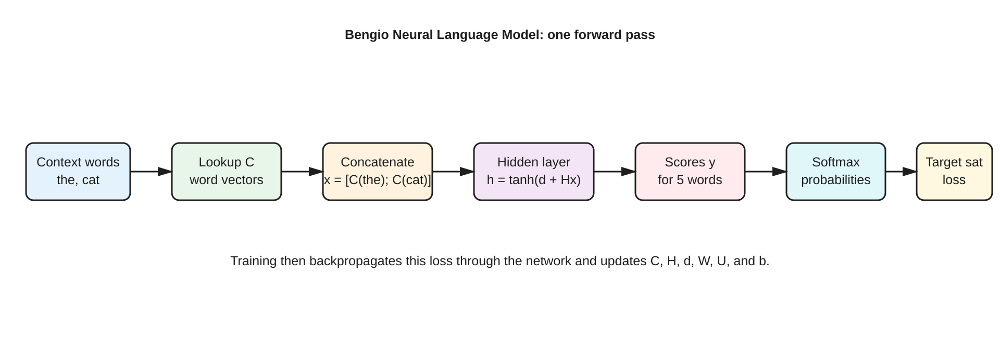

# Bengio neural language model flow

Editable source: [bengio-neural-language-model-flow.excalidraw](./bengio-neural-language-model-flow.excalidraw)

Visual preview:

## How to read the diagram

For the example `the cat → sat`:

1. Look up the vectors `C(the)` and `C(cat)`.
2. Concatenate them into `x`.
3. Compute the hidden representation `h = tanh(d + Hx)`.
4. Compute one score for each possible next word using `y = b + W x + U h`.
5. Apply softmax to obtain a probability distribution over the vocabulary.
6. Select `P(sat | the cat)` and calculate `loss = -log P(sat | the cat)`.

The backward pass sends this loss in the opposite direction and updates both the neural-network parameters and the word-vector table `C`.
