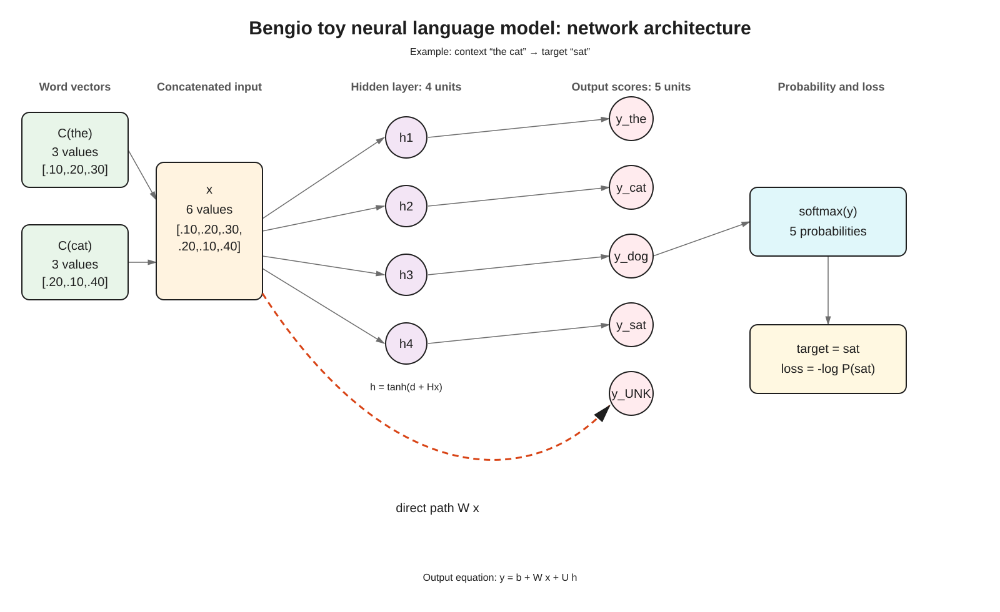

# Bengio toy network architecture

Editable source: [bengio-toy-network-architecture.excalidraw](./bengio-toy-network-architecture.excalidraw)

Architecture preview:



## Exact network represented

```text
C(the), C(cat)  →  x (6 values)
x               →  h (4 hidden units)
x               →  W x (direct output path)
h               →  U h
W x + U h + b   →  y (5 output scores)
y               →  softmax probabilities
P(sat | the cat) → loss
```

The orange dashed connection is the direct `W x` path from the concatenated context vector to the output scores. The regular path is the nonlinear hidden route `x → h → U h`.

Parameter shapes in this toy network:

```text
C: (5, 3)
H: (4, 6)
d: (4,)
W: (5, 6)
U: (5, 4)
b: (5,)
```
