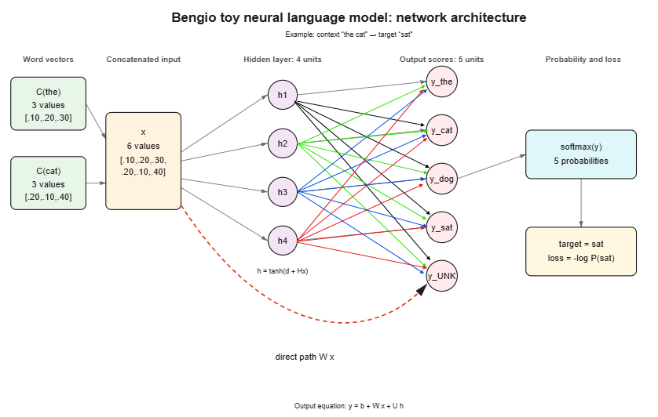

## 0 Context

**Yes, all of the formulas you provided are entirely correct.** They accurately represent the feedforward neural network language model architecture and training objective introduced by Bengio et al. (2003).

Here is a breakdown of how each formula aligns with the paper:

1. **Output Scores Matrix Equation:** **$y = b + Wx + U\tanh(d + Hx)$**
   - **$x$** is the concatenated word embedding/feature vector for the context words.
   - **$d + Hx$** computes the hidden layer pre-activations, which pass through the **$\tanh$** activation function.
   - **$U$** represents the hidden-to-output weight matrix.
   - **$Wx$** represents optional direct connections from the input word features straight to the output logits (bypassing the hidden layer).
   - **$b$** is the unnormalized output bias vector.

2. **Logits for Vocabulary:** **$y = [y_1, y_2, y_3]$ for vocabulary $[v_1, v_2, v_3]$**
   - For a vocabulary size $|V| = 3$, the output vector $y$ contains $3$ real-valued elements (unnormalized log-probabilities or logits), each corresponding to one candidate next word in the vocabulary.

3. **Softmax Probability:** **$P(v_3) = \frac{\exp(y_3)}{\exp(y_1) + \exp(y_2) + \exp(y_3)}$**
   - This is the standard **softmax activation layer** used in the paper to guarantee that output values are positive and sum to 1.

4. **Loss Function:** **$L = -\log(P(v_3))$**
   - The model is trained by maximizing the log-likelihood of the correct context-dependent target word, which is mathematically identical to minimizing the **negative log-likelihood loss** $L = -\log P(w_t \mid context)$.

Would you like to trace how backpropagation and parameter updates (gradients) work for this setup, or see a numerical step-by-step example?

## 1. finding the gradient of the loss with respect to the output logits basically mean dL/dy right? We can write it as delta\_y = d(loss) / d(y) = probabilities - one\_hot(target) right?

**Yes, exactly right.** 

Finding the gradient of the loss with respect to the output logits indeed means computing **$\frac{\partial L}{\partial y}$** (often denoted as **$\delta_y$**), and its simplified form is precisely:

$$\delta_y = \frac{\partial L}{\partial y} = \mathbf{p} - \mathbf{t} = \text{probabilities} - \text{one\_hot}(\text{target})$$

---

### Why does it simplify so cleanly?

Let's break down the math for your 3-word vocabulary where the correct word is $v_3$ (so target vector $\mathbf{t} =^T$):

1. **Loss function written in terms of logits:**
   $$L = -\log(p_3) = -\log\left(\frac{e^{y_3}}{e^{y_1} + e^{y_2} + e^{y_3}}\right) = -y_3 + \log(e^{y_1} + e^{y_2} + e^{y_3})$$

2. **Derivative for incorrect word (e.g., $y_1$):**
   $$\frac{\partial L}{\partial y_1} = 0 + \frac{e^{y_1}}{e^{y_1} + e^{y_2} + e^{y_3}} = p_1 - 0 = p_1$$

3. **Derivative for the correct word ($y_3$):**
   $$\frac{\partial L}{\partial y_3} = -1 + \frac{e^{y_3}}{e^{y_1} + e^{y_2} + e^{y_3}} = p_3 - 1$$

4. **In vector form:**
   $$\delta_y = \begin{bmatrix} p_1 \\ p_2 \\ p_3 \end{bmatrix} - \begin{bmatrix} 0 \\ 0 \\ 1 \end{bmatrix} = \begin{bmatrix} p_1 \\ p_2 \\ p_3 - 1 \end{bmatrix}$$

---

### Intuitive Meaning
* If the model predicts $p_3 = 1.0$ (100% certainty on the correct word), then $\delta_y =^T$ — **zero error**, so no parameter updates occur.
* If $p_3 < 1.0$, $p_3 - 1$ is negative, which pushes $y_3$ **up** during gradient descent, while $p_1$ and $p_2$ are positive, pushing incorrect logits $y_1$ and $y_2$ **down**.

Now that we have $\delta_y$, how would you like to pass this error backward to calculate the gradients for parameters like $b$, $W$, or $U$?

## 2. Ok let's pass this error backward to calculate the gradients for parameter b

To compute the gradient with respect to the output bias vector **$b$**, we apply the **chain rule** connecting the loss $L$, the logits vector $y$, and $b$:

$$\frac{\partial L}{\partial b} = \left(\frac{\partial y}{\partial b}\right)^T \frac{\partial L}{\partial y}$$

---

### Step-by-Step Breakdown

1. **Look at the output equation for $y$:**
   $$y = b + Wx + U\tanh(d + Hx)$$

2. **Compute $\frac{\partial y}{\partial b}$:**
   Notice that $y$ is formed by simply adding $b$ to the other terms ($Wx$ and $U\tanh(d+Hx)$).
   * For element $i$: $y_i = b_i + \text{other terms}$
   * $\frac{\partial y_i}{\partial b_i} = 1$, and $\frac{\partial y_i}{\partial b_j} = 0$ for $i \neq j$.
   * In vector/matrix terms, the Jacobian $\frac{\partial y}{\partial b}$ is just the **Identity matrix $I$**.

3. **Apply the Chain Rule:**
   $$\frac{\partial L}{\partial b} = I \cdot \delta_y = \delta_y = \mathbf{p} - \mathbf{t}$$

---

### Result

The gradient with respect to the output bias vector $b$ is **identical to the error at the output logits $\delta_y$**:

$$\frac{\partial L}{\partial b} = \begin{bmatrix} p_1 \\ p_2 \\ p_3 - 1 \end{bmatrix}$$

And the parameter update rule for $b$ using gradient descent with learning rate $\epsilon$ is:
$$b_{\text{new}} = b_{\text{old}} - \epsilon \begin{bmatrix} p_1 \\ p_2 \\ p_3 - 1 \end{bmatrix}$$

---

What parameter would you like to differentiate next? We can tackle **$W$** (the direct input-to-output weights) or **$U$** (the hidden-to-output weights).

## 3. can tackle $W$ now

To compute the gradient with respect to the direct weight matrix **$W$**, we use the chain rule to see how changes in $W$ flow through the output logits $y$ to affect the loss $L$.

---

### Step-by-Step Breakdown

1. **Understand the dimensions:**
   * **$y$** is a vector of size $|V| \times 1$ (vocabulary size, e.g., $3 \times 1$).
   * **$x$** is the concatenated input feature vector of size $D \times 1$ (where $D = (n-1) \cdot m$, context length times embedding dimension).
   * **$W$** is a matrix of size $|V| \times D$.

2. **Look at an individual logit $y_i$:**
   $$y_i = b_i + \sum_{j=1}^{D} W_{ij} x_j + \text{hidden layer terms}$$

3. **Take the derivative of $y_i$ with respect to weight $W_{ij}$:**
   $$\frac{\partial y_i}{\partial W_{ij}} = x_j$$
   *(Note: $W_{ij}$ only affects logit $y_i$, so $\frac{\partial y_k}{\partial W_{ij}} = 0$ for any $k \neq i$).*

4. **Apply the Chain Rule for an individual element:**
   $$\frac{\partial L}{\partial W_{ij}} = \frac{\partial L}{\partial y_i} \cdot \frac{\partial y_i}{\partial W_{ij}} = \delta_{y, i} \cdot x_j$$

5. **Express in Vector/Matrix Form (Outer Product):**
   When we combine all elements into matrix form, the gradient is the **outer product** of the output error vector $\delta_y$ and the transposed input vector $x^T$:

   $$\frac{\partial L}{\partial W} = \delta_y x^T = (\mathbf{p} - \mathbf{t}) x^T$$

---

### Intuitive Meaning
Each row $i$ of $\frac{\partial L}{\partial W}$ corresponds to word $v_i$ in the vocabulary. 
* If word $v_i$ was **over-predicted** (so $\delta_{y, i} > 0$), its weights with active input features in $x$ will receive positive gradients, causing those weights to **decrease** during gradient descent.
* If word $v_i$ was the **target word** and **under-predicted** (so $\delta_{y, 3} < 0$), its weights receive negative gradients, causing those weights to **increase**.

---

### Parameter Update Rule
$$W_{\text{new}} = W_{\text{old}} - \epsilon (\delta_y x^T)$$

---

Ready for the next step? We can calculate the gradient for **$U$** (the hidden-to-output matrix), or propagate the error deeper into the hidden layer to find gradients for **$d$** and **$H$**.

## 4. calculate the gradient for $U$

To compute the gradient with respect to the hidden-to-output weight matrix **$U$**, we follow a very similar structure to what we did for $W$.

Let's denote the output vector of the hidden layer as **$a$** (the activations after the $\tanh$ nonlinearity):
$$a = \tanh(d + Hx)$$

Now the equation for logits simplifies to:
$$y = b + Wx + Ua$$

---

### Step-by-Step Breakdown

1. **Understand the dimensions:**
   * **$y$** is of size $|V| \times 1$ (e.g., $3 \times 1$).
   * **$a$** is of size $h \times 1$ (where $h$ is the number of hidden units).
   * **$U$** is a matrix of size $|V| \times h$.

2. **Look at an individual logit $y_i$:**
   $$y_i = b_i + (Wx)_i + \sum_{k=1}^{h} U_{ik} a_k$$

3. **Take the derivative of $y_i$ with respect to weight $U_{ik}$:**
   $$\frac{\partial y_i}{\partial U_{ik}} = a_k$$
   *(Just like with $W$, weight $U_{ik}$ only directly affects output logit $y_i$).*

4. **Apply the Chain Rule for an individual element:**
   $$\frac{\partial L}{\partial U_{ik}} = \frac{\partial L}{\partial y_i} \cdot \frac{\partial y_i}{\partial U_{ik}} = \delta_{y, i} \cdot a_k$$

5. **Express in Vector/Matrix Form (Outer Product):**
   Combining all elements across all vocabulary logits and hidden units gives the outer product of the output error vector $\delta_y$ and the transposed activation vector $a^T$:

   $$\frac{\partial L}{\partial U} = \delta_y a^T = \delta_y \tanh(d + Hx)^T$$

---

### Intuitive Meaning
* The matrix $U$ maps hidden representation features to candidate word logits.
* Each entry in the gradient $\frac{\partial L}{\partial U}$ scales the output error for word $i$ by the strength of hidden feature $k$.
* If a hidden neuron $a_k$ was strongly active and word $v_3$ was under-predicted ($\delta_{y,3} < 0$), the weight $U_{3k}$ will receive a negative gradient, causing it to **increase** during gradient descent to favor word $v_3$ whenever that hidden pattern appears.

---

### Parameter Update Rule
$$U_{\text{new}} = U_{\text{old}} - \epsilon (\delta_y a^T)$$

---

Now we're ready to cross the non-linear barrier into the hidden layer! Would you like to compute the error vector at the hidden layer (before $\tanh$) and find the gradients for **$d$** and **$H$** next?

## 5. You wrote $a = \tanh(d + Hx)$; so we will not calculate $\frac{\partial L}{\partial a}$; instead we will directly calculate $\frac{\partial L}{\partial d}$ and $\frac{\partial L}{\partial H}$ right?

Actually, **we do need to calculate $\frac{\partial L}{\partial a}$ as an essential intermediate step** to get $\frac{\partial L}{\partial d}$ and $\frac{\partial L}{\partial H}$. 

Because of the **chain rule**, error flows backward step-by-step through every layer:
$$\text{Loss } L \longrightarrow \text{Logits } y \longrightarrow \text{Activations } a \longrightarrow \text{Pre-activations } (d + Hx) \longrightarrow \text{Parameters } d, H$$

Here is how calculating $\frac{\partial L}{\partial a}$ fits into the chain rule steps:

---

### Step 1: Backpropagate through $U$ to get $\frac{\partial L}{\partial a}$
First, we calculate how the loss changes with respect to the hidden layer activations $a$:
$$\frac{\partial L}{\partial a} = U^T \delta_y$$

* **Dimensions:** $U^T$ is $(h \times |V|)$ and $\delta_y$ is $(|V| \times 1)$, so $\frac{\partial L}{\partial a}$ is a vector of size $(h \times 1)$.

---

### Step 2: Pass through the $\tanh$ derivative (Pre-activation Error $\delta_h$)
Let $h_{\text{pre}} = d + Hx$. Since $a = \tanh(h_{\text{pre}})$, and the derivative of $\tanh(z)$ is $(1 - \tanh^2(z)) = (1 - a^2)$, we apply element-wise multiplication ($\odot$):

$$\delta_h = \frac{\partial L}{\partial h_{\text{pre}}} = \frac{\partial L}{\partial a} \odot (1 - a^2) = (U^T \delta_y) \odot (1 - a^2)$$

---

### Step 3: Compute $\frac{\partial L}{\partial d}$ and $\frac{\partial L}{\partial H}$
Now that we have $\delta_h$ (the error at the pre-activation level), finding the gradients for $d$ and $H$ becomes straightforward:

1. **For bias $d$:**
   $$\frac{\partial L}{\partial d} = \delta_h = (U^T \delta_y) \odot (1 - a^2)$$

2. **For weight matrix $H$:**
   $$\frac{\partial L}{\partial H} = \delta_h x^T = \Big((U^T \delta_y) \odot (1 - a^2)\Big) x^T$$

---

Without calculating $\frac{\partial L}{\partial a}$ first, we wouldn't know how much error to attribute to each hidden unit.

Does this step-by-step chain rule make sense? If you'd like, we can tackle the final gradient: **$\frac{\partial L}{\partial C}$** for the word embedding matrix $C$ (or feature vector $x$).

## 6. ok so from the original equation, how many parameter's gradients have we calculated till now?'

So far, we have calculated the gradients for **5 parameters** directly from the equation $y = b + Wx + U\tanh(d + Hx)$:

1. **$b$** (output bias vector)  
   $\frac{\partial L}{\partial b} = \delta_y$
2. **$W$** (direct input-to-output weight matrix)  
   $\frac{\partial L}{\partial W} = \delta_y x^T$
3. **$U$** (hidden-to-output weight matrix)  
   $\frac{\partial L}{\partial U} = \delta_y a^T$
4. **$d$** (hidden layer bias vector)  
   $\frac{\partial L}{\partial d} = \delta_h$
5. **$H$** (input-to-hidden weight matrix)  
   $\frac{\partial L}{\partial H} = \delta_h x^T$

---

### What's left?
That covers **all 5 explicit parameters** in the logit formula! 

However, in Bengio's model, there is one more set of learnable parameters: **the word feature matrix $C$** (the word embeddings). Since the input vector $x$ is formed by concatenating word vectors from $C$, backpropagation doesn't stop at $x$—it continues back into $C$ to update the word representations themselves.

Would you like to calculate $\frac{\partial L}{\partial x}$ and see how the gradient gets distributed back to update the word embeddings in $C$?

## 7. How do we update the word embedding matrix C?

To update the word embedding matrix **$C$** (the continuous feature vectors assigned to each word in the vocabulary), backpropagation extends one step further—from the concatenated input vector $x$ back to the individual rows of $C$.

Here is how the update works step-by-step:

---

### Step 1: Calculate the Gradient with Respect to Input Vector $x$ ($\frac{\partial L}{\partial x}$)
Recall that $x$ is the vector formed by concatenating the feature vectors of the $(n-1)$ context words:
$$x = (C(w_{t-n+1}), \dots, C(w_{t-1}))$$

Because $x$ flows into both the direct connection matrix $W$ and the hidden layer matrix $H$, it receives error signals through both paths:
$$\frac{\partial L}{\partial x} = W^T \delta_y + H^T \delta_h$$

* **$W^T \delta_y$** is the error coming directly from the output logits.
* **$H^T \delta_h$** is the error backpropagated from the hidden layer pre-activations.

---

### Step 2: Split $\frac{\partial L}{\partial x}$ for Each Context Word
Since $x$ is a concatenated vector of length $(n-1) \times m$ (where $m$ is the embedding dimension), we split the gradient vector $\frac{\partial L}{\partial x}$ back into $(n-1)$ distinct blocks of size $m \times 1$:

$$\frac{\partial L}{\partial x} = \begin{bmatrix} \frac{\partial L}{\partial C(w_{t-n+1})} \\ \vdots \\ \frac{\partial L}{\partial C(w_{t-1})} \end{bmatrix}$$

Each sub-vector $\frac{\partial L}{\partial C(w_{t-k})}$ represents the gradient with respect to the embedding of the $k$-th context word.

---

### Step 3: Update Only the Active Rows in Matrix $C$
Finally, we apply gradient descent to update the word vector for each word $w_{t-k}$ in the input context window:

$$C(w_{t-k})_{\text{new}} = C(w_{t-k})_{\text{old}} - \epsilon \frac{\partial L}{\partial C(w_{t-k})}$$

---

### Key Insight from the Paper
As Bengio et al. highlight, **only the word embeddings for words that actually appear in the input context window receive gradient updates for that training example**. All other rows in the lookup matrix $C$ remain untouched during that step, making the embedding updates sparse and computationally efficient.

---

We have now covered the full forward pass and backpropagation updates for all parameters in the Bengio model: $\delta_y, b, W, U, d, H,$ and $C$. Would you like to summarize all gradient equations together in a quick reference table, or trace a concrete numerical example with numbers?

## 8. summarize all gradient equations together in a quick reference table, and then, trace a concrete numerical example with numbers (keep it as minimal as possible)

Here is the quick reference table summarizing all forward and backward pass equations for the Bengio neural network language model architecture, followed by a minimal numerical trace.

---

### 1. Quick Reference Table: Gradient Equations

In the paper, the model calculates logits as **$y = b + Wx + U\tanh(d + Hx)$**.

| Step / Parameter | Formula | Vector / Matrix Dimensions | Description |
| :--- | :--- | :--- | :--- |
| **Input Vector $x$** | $x = \text{concat}(C(w_{t-n+1}), \dots, C(w_{t-1}))$ | $((n-1)m \times 1)$ | Concatenated context word embeddings. |
| **Hidden Pre-activations** | $h_{\text{pre}} = d + Hx$ | $(h \times 1)$ | Pre-activation input to the hidden layer. |
| **Hidden Activations $a$** | $a = \tanh(h_{\text{pre}})$ | $(h \times 1)$ | Output of the non-linear hidden layer. |
| **Logits $y$** | $y = b + Wx + Ua$ | $(\|V\| \times 1)$ | Unnormalized log-probabilities for vocabulary. |
| **Probabilities $\mathbf{p}$** | $p_i = \frac{e^{y_i}}{\sum_j e^{y_j}}$ | $(\|V\| \times 1)$ | Softmax output distribution over vocabulary. |
| **Loss $L$** | $L = -\log(p_{\text{target}})$ | Scalar | Negative log-likelihood of target word. |
| **Output Logit Error $\delta_y$** | $\delta_y = \mathbf{p} - \mathbf{t}$ | $(\|V\| \times 1)$ | Softmax error ($\mathbf{t}$ is one-hot target). |
| **Output Bias $b$** | $\frac{\partial L}{\partial b} = \delta_y$ | $(\|V\| \times 1)$ | Gradient with respect to output bias. |
| **Direct Weights $W$** | $\frac{\partial L}{\partial W} = \delta_y x^T$ | $(\|V\| \times (n-1)m)$ | Gradient for direct input-to-output matrix. |
| **Hidden-Output Weights $U$** | $\frac{\partial L}{\partial U} = \delta_y a^T$ | $(\|V\| \times h)$ | Gradient for hidden-to-output matrix. |
| **Hidden Activation Error** | $\frac{\partial L}{\partial a} = U^T \delta_y$ | $(h \times 1)$ | Error backpropagated to hidden layer output. |
| **Hidden Pre-activation Error $\delta_h$** | $\delta_h = \frac{\partial L}{\partial a} \odot (1 - a^2)$ | $(h \times 1)$ | Error passed through $\tanh$ derivative. |
| **Hidden Bias $d$** | $\frac{\partial L}{\partial d} = \delta_h$ | $(h \times 1)$ | Gradient with respect to hidden bias. |
| **Input-Hidden Weights $H$** | $\frac{\partial L}{\partial H} = \delta_h x^T$ | $(h \times (n-1)m)$ | Gradient for input-to-hidden matrix. |
| **Input Vector $x$** | $\frac{\partial L}{\partial x} = W^T \delta_y + H^T \delta_h$ | $((n-1)m \times 1)$ | Total error backpropagated to input features. |
| **Embedding Matrix $C$** | $C(w_{t-k})_{\text{new}} = C(w_{t-k}) - \epsilon \frac{\partial L}{\partial C(w_{t-k})}$ | $(m \times 1)$ per context word | Updates applied only to active context words. |

---

### 2. Concrete Numerical Example

Let's trace a tiny setup step-by-step:

#### **Setup & Parameters**
* **Vocabulary:** $V = \{v_1, v_2, v_3\}$ ($|V| = 3$).
* **Target Word:** $v_3$ $\rightarrow$ One-hot target $\mathbf{t} = \begin{bmatrix} 0 \\ 0 \\ 1 \end{bmatrix}$.
* **Context:** 1 word context ($n-1 = 1$), embedding size $m = 1$, hidden units $h = 1$.
* **Learning rate:** $\epsilon = 0.1$.

**Initial Weights:**
* Input embedding: $x = C(v_1) = [1.0]$
* Hidden layer: $d = [0.0]$, $H = [1.0]$
* Output layer: $b = \begin{bmatrix} 0.0 \\ 0.0 \\ 0.0 \end{bmatrix}$, $W = \begin{bmatrix} 0.0 \\ 0.0 \\ 0.0 \end{bmatrix}$, $U = \begin{bmatrix} 1.0 \\ 0.0 \\ -1.0 \end{bmatrix}$

---

#### **Phase 1: Forward Pass**

1. **Hidden Layer Pre-activation:**
   $h_{\text{pre}} = d + Hx = 0.0 + (1.0 \cdot 1.0) = 1.0$

2. **Hidden Layer Activation:**
   $a = \tanh(1.0) \approx 0.762$

3. **Output Logits $y = b + Wx + Ua$:**
   * $y_1 = 0 + 0 + (1.0 \cdot 0.762) = 0.762$
   * $y_2 = 0 + 0 + (0.0 \cdot 0.762) = 0.0$
   * $y_3 = 0 + 0 + (-1.0 \cdot 0.762) = -0.762$

4. **Softmax Probabilities:**
   * $e^{y_1} = e^{0.762} \approx 2.143$
   * $e^{y_2} = e^{0.0} = 1.0$
   * $e^{y_3} = e^{-0.762} \approx 0.467$
   * $\text{Sum} = 2.143 + 1.0 + 0.467 = 3.610$
   
   $$\mathbf{p} = \begin{bmatrix} p_1 \\ p_2 \\ p_3 \end{bmatrix} = \begin{bmatrix} 2.143 / 3.610 \\ 1.0 / 3.610 \\ 0.467 / 3.610 \end{bmatrix} = \begin{bmatrix} 0.594 \\ 0.277 \\ 0.129 \end{bmatrix}$$

5. **Loss:**
   $L = -\log(p_3) = -\log(0.129) \approx 2.048$

---

#### **Phase 2: Backward Pass (Gradients)**

1. **Logit Error ($\delta_y = \mathbf{p} - \mathbf{t}$):**
   $$\delta_y = \begin{bmatrix} 0.594 \\ 0.277 \\ 0.129 \end{bmatrix} - \begin{bmatrix} 0 \\ 0 \\ 1 \end{bmatrix} = \begin{bmatrix} 0.594 \\ 0.277 \\ -0.871 \end{bmatrix}$$

2. **Gradients for Output Parameters ($b$, $W$, $U$):**
   * **$\frac{\partial L}{\partial b} = \delta_y = \begin{bmatrix} 0.594 \\ 0.277 \\ -0.871 \end{bmatrix}$**
   * **$\frac{\partial L}{\partial W} = \delta_y x^T = \begin{bmatrix} 0.594 \\ 0.277 \\ -0.871 \end{bmatrix} [1.0] = \begin{bmatrix} 0.594 \\ 0.277 \\ -0.871 \end{bmatrix}$**
   * **$\frac{\partial L}{\partial U} = \delta_y a^T = \begin{bmatrix} 0.594 \\ 0.277 \\ -0.871 \end{bmatrix} [0.762] = \begin{bmatrix} 0.453 \\ 0.211 \\ -0.664 \end{bmatrix}$**

3. **Backpropagate into Hidden Layer ($d$, $H$):**
   * Error at activation $a$:
     $\frac{\partial L}{\partial a} = U^T \delta_y = [1.0, 0.0, -1.0] \begin{bmatrix} 0.594 \\ 0.277 \\ -0.871 \end{bmatrix} = 0.594 + 0 + 0.871 = 1.465$
   * Pre-activation error $\delta_h$:
     $\delta_h = \frac{\partial L}{\partial a} \odot (1 - a^2) = 1.465 \cdot (1 - 0.762^2) = 1.465 \cdot 0.419 \approx 0.614$
   * **$\frac{\partial L}{\partial d} = \delta_h = [0.614]$**
   * **$\frac{\partial L}{\partial H} = \delta_h x^T = 0.614 \cdot [1.0] = [0.614]$**

4. **Backpropagate to Input & Word Embedding Matrix ($C$):**
   * Error at input vector $x$:
     $\frac{\partial L}{\partial x} = W^T \delta_y + H^T \delta_h = 0 + (1.0 \cdot 0.614) = [0.614]$
   * **Update Word Vector $C(v_1)$:**
     $C(v_1)_{\text{new}} = C(v_1)_{\text{old}} - \epsilon \frac{\partial L}{\partial C(v_1)} = 1.0 - 0.1(0.614) = 0.9386$

---

💡 **Would you like to explore how weight decay regularization or mini-batch updates affect these equations, or write a small Python script to verify these gradient computations?**