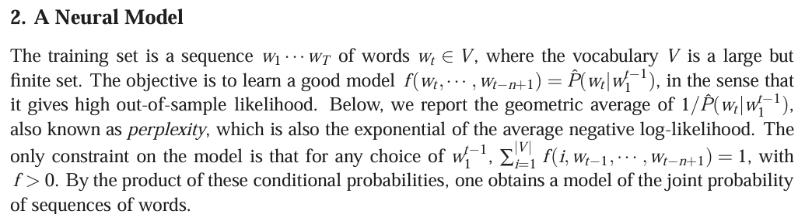

# Understanding texts from the paper



The paragraph defines the language-modeling task:

- The training text is a sequence of words: $w_1, w_2, \ldots, w_T$.
- $V$ is the finite vocabulary.
- The model predicts the current word $w_t$ using previous words, usually the previous $n-1$ words:

  $$\hat{P}(w_t \mid w_{t-1}, \ldots, w_{t-n+1})$$

- The goal is to assign high probability to words in unseen/test text. This is **out-of-sample likelihood**.
- **Perplexity** is another way to report the average prediction quality:

  $$\text{Perplexity} = \exp(\text{average negative log-likelihood})$$

- For every context, the model must assign positive probabilities to all vocabulary words, and those probabilities must sum to 1:

  $$\sum_{i \in V} f(i \mid \text{context}) = 1$$

- Finally, multiplying the conditional next-word probabilities gives the probability of a complete sequence:

  $$P(w_1,\ldots,w_T)=\prod_{t=1}^{T}P(w_t\mid w_1,\ldots,w_{t-1})$$

In short: the model predicts each next word, produces a valid probability distribution, and combines those predictions to obtain the probability of an entire sentence.

## FAQ

### Question: Why does the paper first say “for any choice of $w_1^{t-1}$” and then write $f(i, w_{t-1}, \ldots, w_{t-n+1})$? Shouldn’t it write $f(i, w_1, w_2, \ldots, w_{t-1})$?

Your argument is correct conceptually, but the paper is mixing two levels of notation.

The full-history version would be:

$$
\sum_i P(i \mid w_1, w_2, \ldots, w_{t-1}) = 1
$$

However, Bengio’s model uses only the last $n-1$ words. Therefore its actual function is:

$$
\sum_i f(i, w_{t-1}, \ldots, w_{t-n+1}) = 1
$$

The meaning is:

> For every possible full history, the model must produce a valid probability distribution based on the suffix of that history that it actually uses.

For example, with $n=3$:

```text
Full history: the small black cat
Used context: black cat
```

The model ignores `the small` and calculates:

```text
f(i, black, cat)
```

Thus, your version:

```text
f(i, w1, w2, ..., w_(t-1))
```

would describe a model using the entire history. Bengio’s function instead uses only:

```text
f(i, w_(t-1), ..., w_(t-n+1))
```

The paper mentions the full history because that is the ideal probability being modeled, while the function uses a limited context as an approximation.

### Question: What does this equation mean?

```text
f(i, w_(t-1), ..., w_(t-n+1))
    = g(i, C(w_(t-1)), ..., C(w_(t-n+1)))
```

This says that the model calculates the probability for candidate next word `i` using the learned vector representations of the previous words.

- `i` = a candidate next word.
- `w_(t-1), ..., w_(t-n+1)` = the previous `n-1` words.
- `C(w)` = the learned vector representation of word `w`.
- `g(...)` = the neural-network calculation.
- `f(...)` = the resulting probability assigned to candidate word `i`.

For example:

```text
f(sat, the, cat)
    = g(sat, C(the), C(cat))
```

The model first converts `the` and `cat` into vectors, then the neural network uses those vectors to calculate the probability of `sat`.

## Neural-network output equation

The paper writes:

```text
y = b + W x + U tanh(d + H x)
```

It also says that the values `y_i` are the **unnormalized log-probabilities** for the possible output words.

### What is the equation calculating?

It calculates one raw score for every possible next word in the vocabulary.

For a context such as `the cat`, the model first creates the context vector `x`. It then uses two paths to calculate the output scores:

```text
context vector x
    ├── direct path: W x
    └── hidden path: U tanh(d + H x)
                         ↓
                    output scores y
```

The two paths are added together with the output bias `b`.

### Meaning of each symbol

- `x` = concatenated vector representation of the context words.
- `H` = weights from the context input to the hidden layer.
- `d` = hidden-layer bias.
- `tanh(...)` = nonlinear activation that produces the hidden representation.
- `U` = weights from the hidden layer to the output layer.
- `W` = direct input-to-output weights.
- `b` = output bias.
- `y` = vector of raw output scores.
- `y_i` = raw score for candidate word `i`.

### Why are the scores called “unnormalized”?

The values in `y` are not probabilities yet. They do not have to be between 0 and 1, and they do not have to add up to 1.

The model converts them into probabilities using softmax:

```text
P(word = i | context)
    = exp(y_i) / sum over all vocabulary words j of exp(y_j)
```

The denominator normalizes all scores so that the final probabilities sum to 1.

### Why “log-probabilities”?

Softmax uses exponentials. Therefore, a larger score `y_i` produces a larger probability, and differences between scores correspond to ratios between probabilities:

```text
P(i) / P(j) = exp(y_i - y_j)
```

The scores behave like log-probabilities before normalization, but they are not themselves valid log-probabilities until the normalization term is included.

### What is the role of the two paths?

The direct path `W x` lets the model map the context directly to output scores. The hidden path:

```text
U tanh(d + H x)
```

first creates a nonlinear context representation and then maps it to output scores. The paper can compare models with and without the direct path to study its usefulness.

### Tiny example

Suppose the vocabulary is `{sat, slept, ran}` and the equation produces:

```text
y = [2.0, 1.0, 0.0]
```

These are raw scores, not probabilities. Softmax converts them approximately to:

```text
P(sat)   = 0.665
P(slept) = 0.245
P(ran)   = 0.090
```

The model therefore assigns the highest probability to `sat`, but only after softmax has normalized the raw scores.
